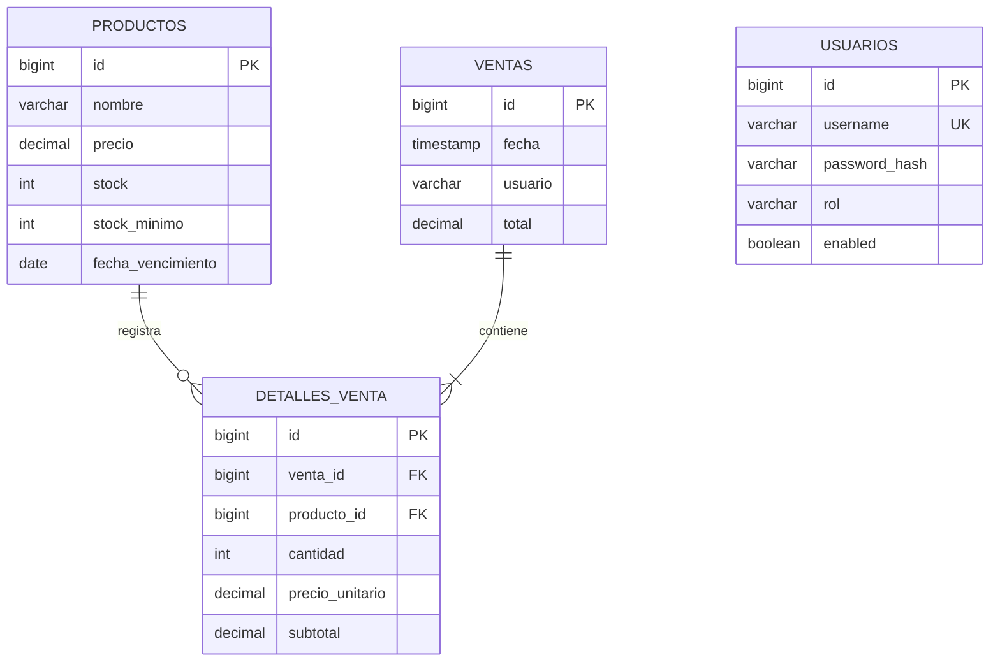

# Tienda MAYEN — Avance de Proyecto 2

El mismo backend del APF1 ahora guarda productos, usuarios y ventas en una base relacional y protege la API con JWT. Se conservan el proyecto Eclipse `gestion`, los endpoints de productos y la arquitectura hexagonal.

Para cargar datos de tienda, importar `postman/Tienda_MAYEN_Datos.postman_collection.json`: incluye 12 productos, cinco ventas, login automático y reutilización de productos existentes. Ver [cómo cargar datos y retirar registros Demo](postman/COMO_CARGAR_DATOS.md). La colección APF2 separada verifica errores intencionales; sus solicitudes indican el código HTTP esperado.

## Ejecutar en Eclipse

Requisitos: Java 21 y acceso a Maven Central para la primera descarga de dependencias.

1. Abrir el proyecto existente `gestion` en Eclipse.
2. Clic derecho → **Maven → Update Project**, para cargar las nuevas dependencias.
3. En **Run Configurations → Java Application**, seleccionar `com.tienda.gestion.GestionApplication` y configurar **Working directory** como la carpeta de este proyecto, la que contiene `pom.xml`.
4. Ejecutar. El perfil local `demo` se activa por defecto, la API escucha en `http://localhost:8080` y las tablas se crean automáticamente.
5. Importar `postman/Tienda_MAYEN_APF2.postman_collection.json` en Postman. Ejecutar la colección en orden con **Collection Runner**.

La base H2 está en `data/tienda-mayen.mv.db`. Es una base relacional en archivo; los datos permanecen al cerrar y volver a ejecutar Java. La conexión incluye `WRITE_DELAY=0` para escribir las transacciones confirmadas sin esperar el intervalo de escritura de H2. La carpeta de trabajo debe ser siempre la misma para apuntar al mismo archivo. No ejecutar dos instancias sobre ese archivo simultáneamente.

Desde PowerShell, ubicado en esta carpeta:

```powershell
.\mvnw.cmd test
.\mvnw.cmd spring-boot:run
```

Para generar y ejecutar el JAR:

```powershell
.\mvnw.cmd package
java -jar target/gestion-0.0.1-SNAPSHOT.jar
```

## Usuarios y permisos locales

| Usuario | Clave demo | Consultar productos | Crear/editar productos | Eliminar productos | Registrar/consultar ventas |
| --- | --- | --- | --- | --- | --- |
| lector | lector123 | Sí | No | No | No |
| editor | editor123 | Sí | Sí | No | Sí |
| admin | admin123 | Sí | Sí | Sí | Sí |

Los usuarios se guardan en la tabla `usuarios`; las claves se guardan con BCrypt. El inicializador solo crea usuarios que todavía no existen y no reemplaza claves existentes al reiniciar. Las claves anteriores y la clave JWT del perfil `demo` son para laboratorio local.

Login:

```http
POST /api/auth/login
Content-Type: application/json

{"username":"editor","password":"editor123"}
```

Devuelve `accessToken`, `tokenType`, `expiresIn`, `username` y `roles`. En cada solicitud protegida enviar `Authorization: Bearer <accessToken>`. El token dura una hora y contiene `sub`, `roles`, `iat`, `exp` e `iss`. El backend valida firma HS256, emisor y expiración. No hay sesiones de login ni refresh tokens en este avance. Cambiar un rol o deshabilitar un usuario afecta a nuevos logins; los tokens ya emitidos siguen vigentes hasta expirar.

Sin autenticación válida se responde **401**; con autenticación pero sin permiso, **403**. La API no acepta Basic Auth: este se utiliza únicamente para la consola local opcional de H2.

## Endpoints

| Método | Ruta | Resultado |
| --- | --- | --- |
| GET | `/api/public/ping` | Comprobación pública del servidor |
| POST | `/api/auth/login` | Login y JWT |
| GET | `/api/productos` | Lista persistente |
| GET | `/api/productos/{id}` | Producto o 404 |
| POST | `/api/productos` | Creación, 201 y header Location |
| PUT | `/api/productos/{id}` | Actualización del mismo ID |
| DELETE | `/api/productos/{id}` | Eliminación, 204; solo ADMIN |
| GET | `/api/productos/stock-bajo` | JPQL: stock menor o igual al mínimo |
| GET | `/api/productos/sin-stock` | JPQL: productos agotados |
| POST | `/api/ventas` | Venta y descuento de inventario en una transacción |
| GET | `/api/ventas` | Historial de ventas |
| GET | `/api/ventas/{id}` | Venta con sus detalles o 404 |

Producto de ejemplo — todos estos campos son obligatorios:

```json
{"nombre":"Arroz","precio":3.50,"stock":10,"stockMinimo":2,"fechaVencimiento":"2027-12-15"}
```

Los IDs de creación los genera la base; un ID enviado en el cuerpo no selecciona ni reemplaza una fila. La URL define el ID de actualización. Los precios admiten hasta diez cifras enteras y dos decimales; el nombre, hasta 120 caracteres. No se permiten precios no positivos ni stocks negativos. Los DTOs de entrada se validan con Jakarta Validation; las entidades JPA no salen en las respuestas REST.

Venta de ejemplo — sustituir los IDs por productos existentes:

```json
{"items":[{"productoId":1,"cantidad":2},{"productoId":2,"cantidad":1}]}
```

Una venta permite entre 1 y 100 productos distintos, con cantidades positivas. El usuario se toma de la autenticación, el precio de la base y el total se calcula con `BigDecimal`. Se guardan los nombres y precios del momento de la venta. Las relaciones `Venta → DetalleVenta` y `DetalleVenta → Producto` preservan la trazabilidad. Un producto vendido no se puede eliminar: se responde **409**, conservando el historial.

## JPQL y transacciones

`ProductoJpaRepository` contiene consultas `@Query` sobre `ProductoEntity` y sus atributos Java, no sobre los nombres SQL de las tablas. Conservan las consultas de stock bajo y sin stock del APF1.

`VentaService.registrar` delimita una única transacción: bloquea los productos por ID en orden, verifica existencias, descuenta stock y guarda venta y detalles. Si un producto posterior no existe o no tiene stock, una excepción provoca rollback, incluyendo los descuentos anteriores. El bloqueo pesimista impide que dos ventas simultáneas consuman la misma última unidad. Crear, actualizar y eliminar productos también tienen fronteras transaccionales; las consultas son de solo lectura.

Errores controlados: **400** datos inválidos, **404** recurso inexistente y **409** stock insuficiente o conflicto de integridad. Las reglas de roles se aplican tanto en HTTP como en los servicios.

## Ver la base con H2 Console

Detener primero la instancia anterior y ejecutar:

```powershell
.\mvnw.cmd spring-boot:run '-Dspring-boot.run.profiles=demo,consola'
```

En Eclipse, el equivalente es agregar `--spring.profiles.active=demo,consola` a **Program arguments**.

Abrir `http://localhost:8080/login` y escribir **admin / admin123** en la página de acceso. El navegador entra luego a H2; la sesión de esta consola no autentica la API JWT. También se admite Basic Auth para herramientas de prueba. Después, en el formulario de conexión H2, usar:

- Driver: `org.h2.Driver`
- JDBC URL: `jdbc:h2:file:./data/tienda-mayen`
- User Name: `sa`
- Password: vacío, salvo que se haya configurado `DB_PASSWORD`.

Ejecutar `database/verificar_datos.sql` y comparar filas, IDs, stock, totales y detalles con Postman. La consola está desactivada normalmente y solo se habilita en el perfil local `consola`.



## Configuración opcional de MySQL

La entrega funciona con H2 sin instalar otro servidor. Para usar MySQL, ejecutar `database/crear_base_mysql.sql`, crear un usuario con permisos sobre esa base y establecer `DB_USER` y `DB_PASSWORD` en las variables de entorno de la configuración de ejecución de Eclipse. Activar `demo,mysql` para el laboratorio. La URL predeterminada es `jdbc:mysql://localhost:3306/tienda_mayen`; se puede reemplazar con `DB_URL`.

Hibernate usa `ddl-auto=update` para crear/actualizar las tablas durante el laboratorio. Las pruebas ejecutadas corresponden a H2; el perfil MySQL requiere una instancia externa y no se certifica como probado sin ella.

Para un entorno ajeno al laboratorio, activar un perfil distinto de `demo`, proporcionar `JWT_SECRET` (al menos 32 bytes), credenciales de base y usuarios propios. El bootstrap está desactivado normalmente fuera de `demo`; si se activa mediante `BOOTSTRAP_USERS=true`, también se requieren las propiedades `app.bootstrap.admin-password`, `app.bootstrap.editor-password` y `app.bootstrap.lector-password`. No guardar secretos ni el archivo de base de datos en Git.

## Pruebas y evidencia

Verificación del 7 de octubre de 2026: **28 pruebas Java aprobadas**, **29 solicitudes Postman y 40 aserciones aprobadas**, y reinicio real del JAR con producto, venta, detalle y stock recuperados desde H2 en archivo. El JAR se generó correctamente. El resumen del checklist está en `PryectoFinal/Documentacion/Avance_2/ESTADO_APF2.md` desde la raíz del curso.

`APF2IntegrationTest` verifica la API con Spring Security y una base H2 de pruebas: CRUD y filas SQL, JPQL, matriz de roles, BCrypt, claims JWT, firma alterada, expiración, emisor incorrecto, CORS, rollback, validación y concurrencia. También se conservan las pruebas de APF1. La base de pruebas es en memoria, independiente de `data/tienda-mayen`.

La colección Postman tiene 29 solicitudes con aserciones. Los tres logins guardan sus tokens automáticamente. Demuestra 200/201/204, 400, 401, 403, 404 y 409, además de rollback y preflight CORS. El token expirado incluido está firmado con la clave demo; si se cambia la clave, seguirá respondiendo 401 por firma inválida y la prueba automatizada Java seguirá cubriendo expiración con la clave de tests. El Runner crea productos y ventas de demostración.

Para comprobar un reinicio real del JAR y ejecutar también Postman mediante Newman (Node.js requerido solo para Newman):

```powershell
.\mvnw.cmd package
.\scripts\verificar_reinicio.ps1 -EjecutarPostman
```

El script usa un puerto libre y una base aislada en `target/apf2-verificacion/`. Arranca el JAR, crea producto y venta, comprueba la consola, ejecuta Postman, detiene su propio proceso y vuelve a arrancarlo para verificar stock, venta y detalles persistentes. Guarda `reinicio.json`, `newman.json` y los logs. No modifica la base local normal. Sin `-EjecutarPostman` verifica solo arranque, consola y reinicio.

## Relación con los materiales

| Semana | Aplicación en Tienda MAYEN |
| --- | --- |
| 5: Servlets, parámetros y atributos | Se mantiene Spring MVC sobre el contenedor servlet. Se usan rutas, JSON validado y `Principal` por request; no se guardan usuarios en variables compartidas ni sesiones para JWT. |
| 6: JPA/Hibernate y CRUD | Entidad separada del dominio, `JpaRepository`, adaptador persistente, H2 en archivo y consola opcional. |
| 7: JPQL y transacciones | Consultas explícitas de inventario, venta atómica y pruebas de rollback. |
| 8: Spring Security | LECTOR, EDITOR y ADMIN; BCrypt, reglas HTTP y `@PreAuthorize`. |
| 9: JWT y CORS | Login, encoder/decoder, claims, expiración, Bearer, API stateless, preflight y origen Angular explícito. |

CORS permite `http://localhost:4200`; se puede configurar con `CORS_ORIGINS`. Angular corresponde al APF3 del checklist y no forma parte de APF2.

La implementación de memoria queda como referencia histórica sin registrarse como bean. `README_Tienda_MAYEN_APF1.md` e informes del APF1 conservan la descripción de la entrega anterior.

Fuentes técnicas: [persistencia y consola en Spring Boot](https://docs.spring.io/spring-boot/reference/data/sql.html), [validación JWT en Spring Security](https://docs.spring.io/spring-security/reference/servlet/oauth2/resource-server/jwt.html), [transacciones de Spring Data JPA](https://docs.spring.io/spring-data/jpa/reference/jpa/transactions.html).
